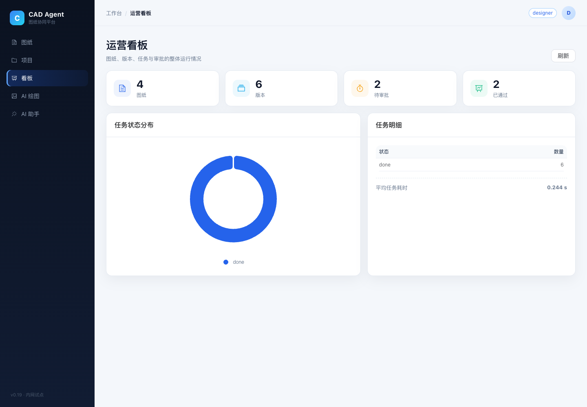
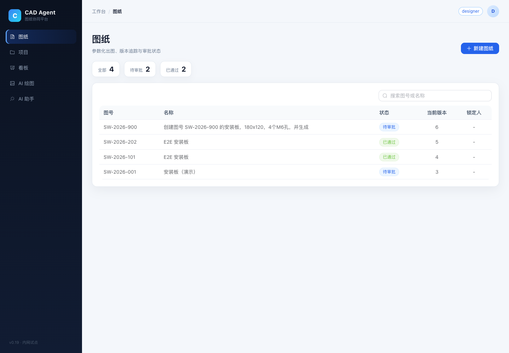
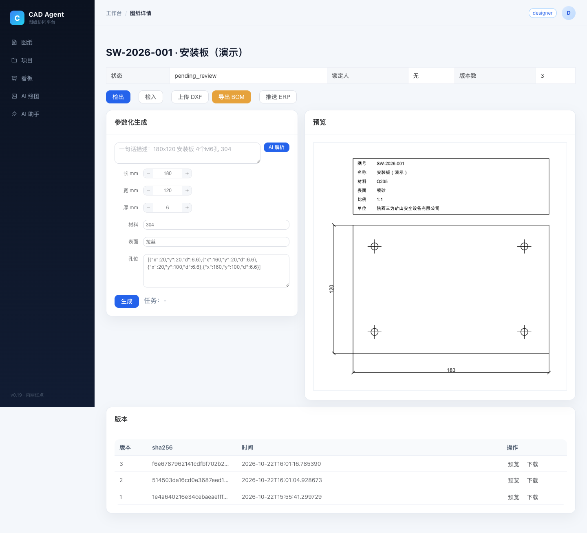
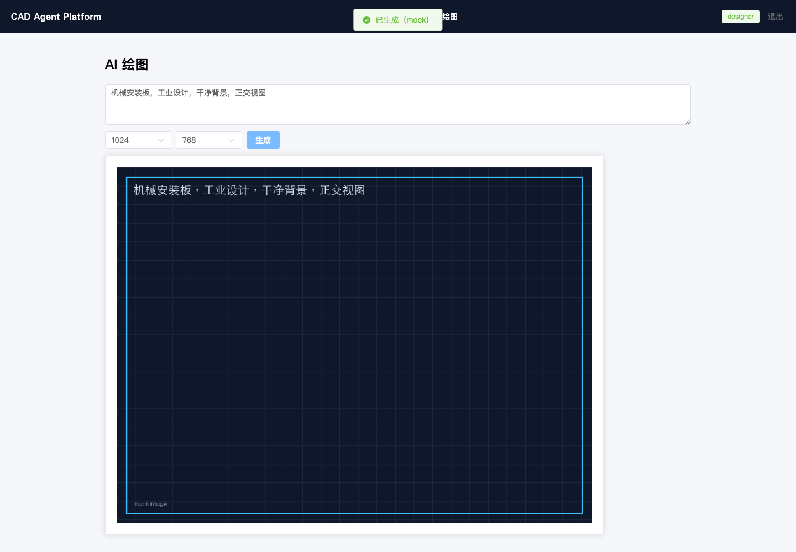

# CAD Agent Platform

[中文](#中文) | [English](#english)

CAD 协同与参数化出图平台：Vue 3 + FastAPI + PostgreSQL/SQLite + Redis，覆盖图纸版本、审批、检出锁、审计、DXF 生成、BOM、AI 解析/绘图与 RAG 知识库。

> 状态：**内网试点可用**。真实 SolidWorks/AutoCAD/Altium、ComfyUI、ERP、企业微信、MinIO 尚未在本仓库验证，详见 [限制](docs/limitations.md)。

## 功能

- 账号/角色：admin、designer、reviewer、viewer；企微 SSO mock。
- 项目/成员：项目隔离、负责人保护、成员角色。
- 图纸/版本：不可变版本、审批、检出/检入、审计。
- DXF：矩形板、孔、圆角、倒角、腰形槽、矩形开口、异形轮廓；轮廓内特征校验。
- 上传：DXF/DWG、大小/结构/病毒扫描；BOM CSV、ERP mock。
- AI：参数解析、Agent 工具调用、图像 mock/远程/ComfyUI 适配、RAG 知识库。
- 任务：Redis 队列、ack/requeue、自动重试、死信、SSE 进度、取消/重试。
- 体验：深色模式、命令面板、骨架屏、中英 i18n。
- 运维：Prometheus/Grafana、备份/恢复/校验、审计清理。

## 截图

| 图纸 | 详情 |
|---|---|
|  |  |

| 看板 | AI 绘图 |
|---|---|
|  |  |

## 技术栈

| 层 | 技术 |
|---|---|
| 前端 | Vue 3、Vite、Element Plus、Pinia、TanStack Query、ECharts |
| 后端 | FastAPI、SQLAlchemy 2、Pydantic 2、Alembic |
| 数据 | PostgreSQL/SQLite、Redis |
| 测试 | pytest、Playwright、ruff |

## 快速开始

~~~bash
git clone https://github.com/GUIDchen/cad-agent-platform.git
cd cad-agent-platform
cp backend/.env.example backend/.env
python3 -m venv .venv
.venv/bin/pip install -r backend/requirements-dev.txt
cd frontend && npm ci && npm run build && cd ..
.venv/bin/uvicorn app.main:app --app-dir backend --host 127.0.0.1 --port 8000
~~~

打开 http://127.0.0.1:8000 ，使用开发态角色登录。生产部署见 [部署文档](docs/deployment.md)。

前端开发：

~~~bash
cd frontend
npm run dev
~~~

## 测试

~~~bash
.venv/bin/pytest -q
.venv/bin/ruff check backend tests tools
cd frontend && npm run e2e
~~~

当前基线：**139 后端测试 + 15 E2E**（Chrome 桌面/移动 + WebKit）。CI 为缩短安装时间只跑 Chromium；WebKit 在本地/发布前验证。

## 目录

~~~text
backend/        FastAPI 应用、模型、服务、DXF、AI
frontend/       Vue 3 SPA、E2E
migrations/     Alembic
deploy/         Compose、Prometheus、Grafana
tools/          备份、恢复、校验、向量导出、适配器验收
worker/         队列 worker 与适配器样例
docs/           架构、开发、部署、API、限制
~~~

## 文档

- [架构](docs/architecture.md)
- [开发](docs/development.md)
- [部署](docs/deployment.md)
- [API](docs/api.md)
- [限制](docs/limitations.md)
- [路线图](docs/roadmap.md)

## 已知限制

- 真实 CAD/EDA 适配器（ODA、AutoCAD COM、SolidWorks、Altium）未在本仓库验证。
- ComfyUI/远程绘图、ERP、企业微信、MinIO、ClamAV 需要外部环境。
- 默认 embedding 是本地字符 hash；可配置远程 embedding/rerank。
- i18n 已覆盖主要页面，仍有零散文案。
- 备份仅提供工具与演练脚本，未在生产数据上执行。

## 贡献

见 [CONTRIBUTING.md](CONTRIBUTING.md)。安全问题见 [SECURITY.md](SECURITY.md)。

## License

MIT，见 [LICENSE](LICENSE)。

---

## English

CAD Agent Platform is a collaborative CAD and parametric drawing platform built with Vue 3 and FastAPI. It provides projects, drawings, immutable versions, approvals, checkout locks, audit logs, DXF generation (holes, fillets, chamfers, slots, cutouts, polygon outlines), BOM export, AI parsing/agent tools, a RAG knowledge base, and a Redis-backed job queue.

It is **pilot-ready for internal use**, but real CAD/EDA adapters and external AI/ERP integrations are not verified in this repository. See [limitations](docs/limitations.md).

MIT licensed.
